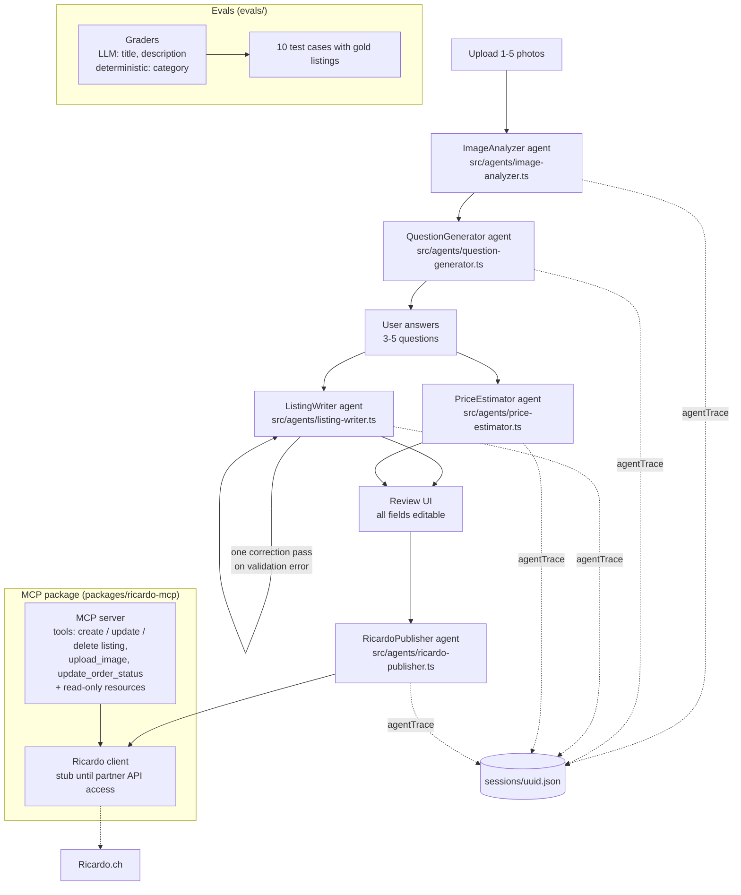

# AI Listing Assistant (Verkaufshilfe via Foto)


**Photo → complete Ricardo.ch listing, bilingual DE/FR, written by a five-agent AI pipeline, with a human review step before publishing.**

> **Status:** The pipeline from photo to reviewed listing works end to end. Publishing runs against a stub Ricardo.ch client until partner API access is granted; the MCP server package wraps the same client.

<!-- HERO-VISUAL — bitte hier ein Bild einfügen (stärkster visueller Hebel):
     Screenshot-Strecke der 5-Phasen-Wizard-UI (Upload → Analyse → Rückfragen
     → Inserat → Review), idealerweise als eine zusammengesetzte Grafik oder
     ein kurzes GIF eines echten Durchlaufs.
     1. Bild ablegen unter  docs/wizard-walkthrough.png  und den Pfad in die
        Sync-Allowlist in .github/workflows/push-to-public.yml aufnehmen.
     2. Folgende Zeile einkommentieren:

-->

## What it does

Upload 1–5 photos of any item you want to sell. The assistant runs an agentic pipeline: image analysis extracts object, condition, and category; a question generator asks only what the photos cannot answer; a listing writer produces a complete, bilingual (DE/FR) Ricardo.ch listing with title, description, price estimate, and shipping conditions; after your review, a publisher hands it to the Ricardo.ch client (a stub for now, see status). You get a listing ready to publish without writing the copy yourself.

Built as an applied AI engineering case: typed agent contracts (Zod), a ListingWriter that corrects its own validation errors, LLM-as-judge evals across three prompt versions, and per-agent tracing via `agentTrace`. It also ships a standalone, publish-ready MCP server package. Each concept maps to inspectable source code.

## Architecture



Detailed component descriptions: [docs/architecture.md](docs/architecture.md)

## Engineering decisions

| Concept | Where | Why it matters |
|---------|-------|----------------|
| Agentic pipeline | `src/agents/` | Five typed agents with defined inputs/outputs replace a single monolithic prompt; each agent has one responsibility and can be tested in isolation |
| Structured outputs (Zod) | `src/agents/schemas.ts`, all agent files | `zodOutputFormat` (`output_config.format`) enforces JSON contracts at the SDK layer; no manual JSON parsing or regex extraction in agent code |
| Self-correcting agent | `src/agents/listing-writer.ts` | If the output fails `ListingValidationSchema`, the ListingWriter gets the error back for one correction pass; a title that is still too long is then cut to 60 characters |
| Observability (agentTrace) | `src/types/session.ts` | Every agent call appends a structured `AgentTraceEntry` (model, tokens, duration, input/output) to `SessionState.agentTrace`; a whole run can be replayed from one JSON file |
| LLM-as-judge evals | `evals/graders/` | Title and description graders use Claude to score outputs against multi-criterion rubrics; the category grader is deterministic |
| Prompt comparison | `evals/run-eval.ts`, `evals/prompts/` | Three prompt versions run against 10 fixed test cases; results are committed including failures (EVAL-07), progression in `evals/results/progression.md` |
| MCP server | `packages/ricardo-mcp/` | Standalone package that exposes Ricardo.ch operations as MCP tools and read-only resources; ready for `npm publish`, not yet published. The RicardoPublisher uses the package's client directly |
| Defense-in-depth security | `src/lib/sanitize.ts`, `src/lib/session.ts`, `.husky/pre-commit` | Session ID validated against path traversal; user answers sanitized against prompt injection; secretlint pre-commit hook blocks credential leaks |

## Setup

```bash
npm install
cp .env.example .env.local
# Edit .env.local: set ANTHROPIC_API_KEY=sk-ant-...
# RICARDO_PARTNERSHIP_KEY / _PASSWORD stay empty until partner API access (stub mode)
npm run dev
```

Open [http://localhost:3000](http://localhost:3000).

## Running the evals

```bash
npm run eval:v1   # baseline prompt
npm run eval:v2   # improved title length + description limits
npm run eval:v3   # feature-keyword directive + 3-sentence formula
```

Results are committed to [`evals/results/progression.md`](evals/results/progression.md). Each run JSON is committed alongside, including runs that contain failures.

## Eval results

| Prompt Version | Title Avg Score | Description Avg Score | Category Exact Match |
|---------------|-----------------|----------------------|----------------------|
| v1 (baseline) | 0.94 | 0.94 | 100% |
| v2 | 0.93 | 0.97 | 100% |
| v3 | 0.93 (9/10 cases) | 0.97 (9/10 cases) | 100% |

Full score breakdown and honest notes on regressions: [`evals/results/progression.md`](evals/results/progression.md)

Eval methodology and grader rubrics: [`docs/eval-report.md`](docs/eval-report.md)

## Project structure

```
src/
  agents/          # Five typed AI agents (image-analyzer, question-generator,
                   # listing-writer, price-estimator, ricardo-publisher) + schemas
  app/             # Next.js App Router: 5 wizard pages, an orders page, 8 API routes
  lib/             # Business logic: session persistence, sanitize, anthropic client
  types/           # SessionState, AnalysisResult, Listing, AgentTraceEntry, ...
packages/
  ricardo-mcp/     # Standalone, publish-ready MCP server package for Ricardo.ch API integration
evals/
  cases/           # 10 test cases: gold-standard listings, user answers (photos not committed)
  graders/         # LLM-as-judge graders: title, description, category
  prompts/         # Versioned listing prompts (v1, v2, v3)
  results/         # Committed run JSONs + progression.md score table
docs/
  architecture.md  # Detailed system diagram + component responsibilities
  eval-report.md   # Eval methodology, A/B testing, score progression
  sync-workflow.md # Private-to-public GitHub Actions sync documentation
```

## Tech stack

- **Next.js 16**: App Router, TypeScript, server-side API routes
- **@anthropic-ai/sdk**: Claude Sonnet 4.6 for all AI calls; `zodOutputFormat` for structured outputs
- **Zod**: Agent output schemas and validation contracts
- **sharp**: Server-side image resizing before API calls
- **Vitest**: Unit tests for agents and graders
- **promptfoo**: installed; the evals currently run through `evals/run-eval.ts`
- **MCP SDK** (`@modelcontextprotocol/sdk`): Ricardo.ch tool server in `packages/ricardo-mcp`

## How this repo is published

The source code lives in a private GitHub repository. A GitHub Actions workflow (`.github/workflows/push-to-public.yml`) syncs an allowlisted subset of files to the public mirror at `github.com/kronprinzmagma/ai-listing-assistant` on every push to `main`. Only allowlisted paths are copied; a credential scan and secretlint run on the staged files and stop the publish if they find anything. See [`docs/sync-workflow.md`](docs/sync-workflow.md) for the full sync design and allowlist.

## License

MIT
