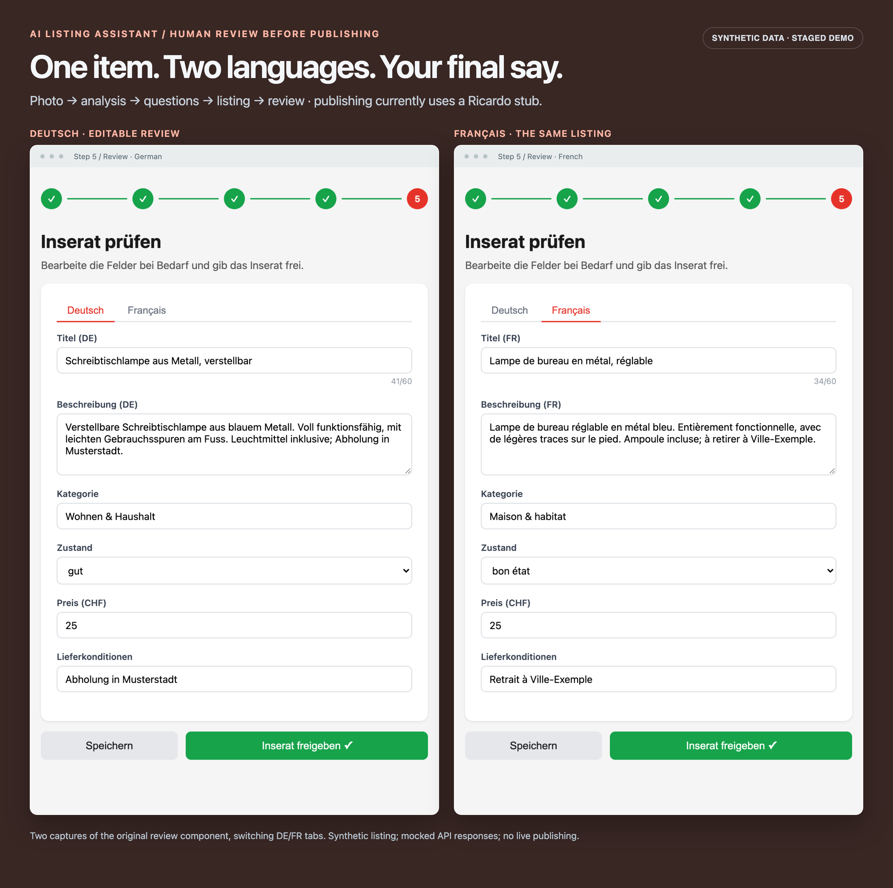
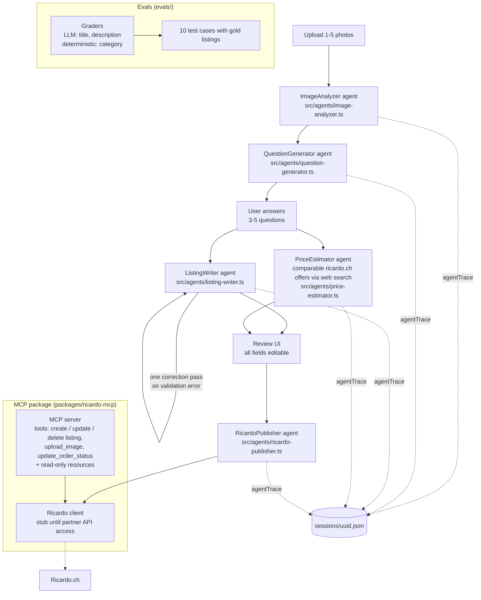

# AI Listing Assistant (Verkaufshilfe via Foto)


**Photo → complete Ricardo.ch listing, bilingual DE/FR, written by a five-agent AI pipeline, with a human review step before publishing.**

> **Status:** The pipeline from photo to reviewed listing works end to end. Publishing runs against a stub Ricardo.ch client until partner API access is granted; the MCP server package wraps the same client.



*Staged UI demo: two captures of the same DE/FR review component with synthetic listing data and mocked API responses. Ricardo publishing currently uses a stub. [Visual provenance](docs/hero-visual.md).*

## What it does

Upload 1–5 photos of any item you want to sell. The assistant runs an agentic pipeline: image analysis extracts object, condition, and category; a question generator asks only what the photos cannot answer; a listing writer produces a complete, bilingual (DE/FR) Ricardo.ch listing with title, description, price, and shipping conditions, while a price estimator looks up comparable offers on ricardo.ch and replaces the price with one backed by those offers where it finds matches; after your review, a publisher hands it to the Ricardo.ch client (a stub for now, see status). You get a listing ready to publish without writing the copy yourself.

Built as an applied AI engineering case: typed agent contracts (Zod), a ListingWriter that corrects its own validation errors, LLM-as-judge evals across three prompt versions, and per-agent tracing via `agentTrace`. It also ships a standalone, publish-ready MCP server package. Each concept maps to inspectable source code.

## Architecture



Detailed component descriptions: [docs/architecture.md](docs/architecture.md)

## Engineering decisions

| Concept | Where | Why it matters |
|---------|-------|----------------|
| Agentic pipeline | `src/agents/` | Five typed agents with defined inputs/outputs replace a single monolithic prompt; each agent has one responsibility and can be tested in isolation |
| Structured outputs (Zod) | `src/agents/schemas.ts`, all agent files | `zodOutputFormat` (`output_config.format`) enforces JSON contracts at the SDK layer; no manual JSON parsing or regex extraction in agent code |
| Self-correcting agent | `src/agents/listing-writer.ts` | If the output fails `ListingValidationSchema`, the ListingWriter gets the error back for one correction pass; a title that is still too long is then cut to 60 characters |
| Grounded price | `src/agents/price-estimator.ts` | The price comes from comparable offers found with the Claude API web search tool (restricted to ricardo.ch); link and price of each result are read in code, Claude only picks the matching ones, and the review shows the links. Without matches it falls back to a model-only estimate marked as such |
| Observability (agentTrace) | `src/types/session.ts` | Every agent call appends a structured `AgentTraceEntry` (model, tokens, duration, input/output) to `SessionState.agentTrace`; a whole run can be replayed from one JSON file |
| LLM-as-judge evals | `evals/graders/` | Title and description graders use Claude to score outputs against multi-criterion rubrics; the category grader is deterministic |
| Prompt comparison | `evals/run-eval.ts`, `evals/prompts/` | Three prompt versions run against 10 fixed test cases; results are committed including failures (EVAL-07), progression in `evals/results/progression.md` |
| MCP server | `packages/ricardo-mcp/` | Standalone package that exposes Ricardo.ch operations as MCP tools and read-only resources; ready for `npm publish`, not yet published. The RicardoPublisher uses the package's client directly |
| Defense-in-depth security | `src/lib/sanitize.ts`, `src/lib/session.ts`, `.husky/pre-commit` | Session ID validated against path traversal; user answers sanitized against prompt injection; secretlint pre-commit hook blocks credential leaks |

## Setup

```bash
npm install
cp .env.example .env.local
# Edit .env.local: set ANTHROPIC_API_KEY=sk-ant-...
# RICARDO_PARTNERSHIP_KEY / _PASSWORD stay empty until partner API access (stub mode)
npm run dev
```

Open [http://localhost:3000](http://localhost:3000).

## Running the evals

```bash
npm run eval:v1   # baseline prompt
npm run eval:v2   # improved title length + description limits
npm run eval:v3   # feature-keyword directive + 3-sentence formula
```

Results are committed to [`evals/results/progression.md`](evals/results/progression.md). Each run JSON is committed alongside, including runs that contain failures.

The same cases and graders also run through promptfoo, with all three prompt versions side by side ([`evals/promptfooconfig.yaml`](evals/promptfooconfig.yaml)). The private source repository runs this config manually in GitHub Actions with [promptfoo-action](https://github.com/promptfoo/promptfoo-action); it is `workflow_dispatch` only because each run costs API credits. Locally:

```bash
NODE_OPTIONS='--import tsx' npx promptfoo eval -c evals/promptfooconfig.yaml --no-share
```

### Quality eval in GitHub Actions

The workflow **Prompt-Evals** ([`.github/workflows/eval.yml`](.github/workflows/eval.yml)) runs `evals/promptfooconfig.yaml` for v1, v2 and v3 side by side and writes average scores per version and metric to the run summary; the result JSON is kept as a run artifact for 30 days. It starts only by hand (`workflow_dispatch`): no schedule, no runs on pull requests, because every run calls Claude and costs API credits. Without the repository secret `ANTHROPIC_API_KEY` it stops before installing anything and says so in the log and the run summary. It is separate from the prompt-injection evals in [`.github/workflows/injection.yml`](.github/workflows/injection.yml).

Result: not yet measured (first run pending).

## Eval results

Measured on 2026-05-21 with `evals/run-eval.ts`, one run per version, 10 cases. Claude Sonnet 4.6 writes the listings and also grades them.

| Prompt Version | Title Avg Score | Description Avg Score | Category Exact Match | Source |
|---------------|-----------------|----------------------|----------------------|--------|
| v1 (baseline) | 0.94 | 0.94 | 100% | [run JSON](evals/results/run-v1-2026-05-21T12-17-12-235Z.json) |
| v2 | 0.93 | 0.97 | 100% | [run JSON](evals/results/run-v2-2026-05-21T12-20-50-028Z.json) |
| v3 | 0.93 (9/10 cases) | 0.97 (9/10 cases) | 100% | [run JSON](evals/results/run-v3-2026-05-21T12-24-06-841Z.json) |

Status of this table: MEASURED (sources linked per row). promptfoo run in CI: UNMEASURED, first run pending.

Full score breakdown and honest notes on regressions: [`evals/results/progression.md`](evals/results/progression.md)

Eval methodology and grader rubrics: [`docs/eval-report.md`](docs/eval-report.md)

## Metrics status

Every quality or cost statement about this project is labeled by how it is backed:

- **MEASURED**: backed by a committed result file in this repo.
- **ASSUMPTION**: a set value or interpretation that no measurement backs yet.
- **UNMEASURED**: no data yet; no number is claimed.

| Statement | Status | Basis |
|-----------|--------|-------|
| Title, description and category scores per prompt version (table above) | MEASURED | Run JSONs in `evals/results/`; one run each; title and description by LLM judge, category by exact match; German fields only |
| v2 to v3 title and description changes are within run-to-run noise | ASSUMPTION | Single run per version; no repeated runs to estimate variance |
| Pass threshold 0.8 for title and description in the promptfoo config | ASSUMPTION | Starting value, not calibrated |
| Scores from the promptfoo workflow (all three versions in one run) | UNMEASURED | Workflow exists, first run pending |
| Quality of the generated French text | UNMEASURED | Graders score the German fields only |
| Price estimate quality (PriceEstimator) | UNMEASURED | Cases contain an expected price range, but no grader checks prices |
| Image analysis accuracy (ImageAnalyzer) | UNMEASURED | Eval cases skip image analysis; photos are not committed |
| Cost per listing (tokens, CHF) | UNMEASURED | `agentTrace` records tokens per agent call, but no runs have been aggregated |
| End-to-end latency per listing | UNMEASURED | `agentTrace` records `durationMs`; not aggregated yet |

## Project structure

```
src/
  agents/          # Five typed AI agents (image-analyzer, question-generator,
                   # listing-writer, price-estimator, ricardo-publisher) + schemas
  app/             # Next.js App Router: 5 wizard pages, an orders page, 8 API routes
  lib/             # Business logic: session persistence, sanitize, anthropic client
  types/           # SessionState, AnalysisResult, Listing, AgentTraceEntry, ...
packages/
  ricardo-mcp/     # Standalone, publish-ready MCP server package for Ricardo.ch API integration
evals/
  cases/           # 10 test cases: product metadata + gold-standard listings (photos not committed)
  graders/         # LLM-as-judge graders: title, description, category
  prompts/         # Versioned listing prompts (v1, v2, v3)
  promptfoo/       # Test loader and assertions for promptfooconfig.yaml
  results/         # Committed run JSONs + progression.md score table
docs/
  architecture.md  # Detailed system diagram + component responsibilities
  eval-report.md   # Eval methodology, A/B testing, score progression
  sync-workflow.md # Private-to-public GitHub Actions sync documentation
```

## Tech stack

- **Next.js 16**: App Router, TypeScript, server-side API routes
- **@anthropic-ai/sdk**: Claude Sonnet 5.5 for all agent calls (graders: Sonnet 4.6); `zodOutputFormat` for structured outputs
- **Zod**: Agent output schemas and validation contracts
- **sharp**: Server-side image resizing before API calls
- **Vitest**: Unit tests for agents and graders
- **promptfoo**: side-by-side eval of the prompt versions (`evals/promptfooconfig.yaml`); `evals/run-eval.ts` writes the committed run JSONs
- **MCP SDK** (`@modelcontextprotocol/sdk`): Ricardo.ch tool server in `packages/ricardo-mcp`

## How this repo is published

The source code lives in a private GitHub repository. A GitHub Actions workflow (`.github/workflows/push-to-public.yml`) syncs an allowlisted subset of files to the public mirror at `github.com/kronprinzmagma/ai-listing-assistant` on every push to `main`. Only allowlisted paths are copied; a credential scan and secretlint run on the staged files and stop the publish if they find anything. See [`docs/sync-workflow.md`](docs/sync-workflow.md) for the full sync design and allowlist.

## License

MIT
