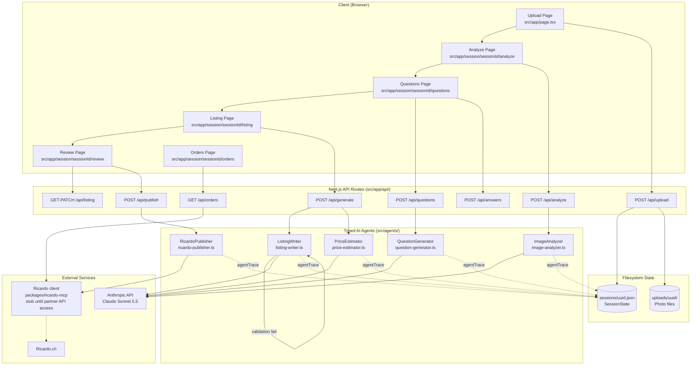

# Architecture

## System diagram

## Component responsibilities

| Component | File | Responsibility |
|-----------|------|----------------|
| ImageAnalyzer | `src/agents/image-analyzer.ts` | Resizes photos with sharp, sends to Claude vision, returns `AnalysisResult` (object, condition, category, title/description drafts); the category must come from the fixed list in `src/lib/categories.ts` (enum in the output schema), which the listing writer, review and publisher share. The list (23 entries) is final per Nils' decision of 2026-11-19; its IDs stay placeholders until Partner API access exists |
| QuestionGenerator | `src/agents/question-generator.ts` | Given `AnalysisResult`, generates 3–5 targeted questions about non-visible information only |
| ListingWriter | `src/agents/listing-writer.ts` | Generates a complete bilingual (DE/FR) Ricardo.ch listing; on a `ListingValidationSchema` failure one correction pass, then a hard title cut at 60 characters (PIPE-10) |
| PriceEstimator | `src/agents/price-estimator.ts` | Looks up comparable offers on ricardo.ch via the Claude API web search tool (search index only, `allowed_domains: ricardo.ch`, no page fetch), reads link and price from each result in code, lets Claude pick the matching ones by number and checks the suggestion against their prices; without matches it falls back to a model-only estimate marked `source: 'modell'`. The review shows price, rationale and links; a comparable-based price replaces the writer's price |
| RicardoPublisher | `src/agents/ricardo-publisher.ts` | Calls the Ricardo.ch client from `packages/ricardo-mcp` (a stub until partner API access) and stores `publishedListingId` and `publishedUrl` in the session |
| Agent orchestrator | `src/agents/index.ts` | Re-exports the entry points of the four Claude agents (the RicardoPublisher is imported directly by `/api/publish`); documents pipeline order and parallelism (ListingWriter + PriceEstimator run in parallel in /api/generate) |
| Agent schemas | `src/agents/schemas.ts` | Zod schemas for all agent inputs and outputs; `zodOutputFormat` contracts enforced at SDK layer |
| Model config | `src/lib/models.ts` | One place for model ID (`claude-sonnet-5-5`) and `effort: low` of all Claude agents, plus the system note `DATA_GUARD_SYSTEM` against instructions hidden in photo or answer text |

## Data flow: session state accumulation

| Step | Fields Added to SessionState | Notes |
|------|------------------------------|-------|
| Upload | `id`, `createdAt`, `photoPaths` | UUID generated; files written to `uploads/{id}/`; session JSON created |
| Analyze | `analysis` (`AnalysisResult`) | `agentTrace[0]` appended; photos passed through sharp resize before API call |
| Questions | `questions` (`Question[]`) | Each question has a generated UUID; `agentTrace[1]` appended |
| Answers | `questions[].answer` populated | User answers pass through `src/lib/sanitize.ts` (`sanitizeUserAnswer`) before being written to the session; prompt injection mitigation (REPO-06) |
| Generate | `listing` (`Listing`), `priceEstimate` (`PriceEstimate`) | ListingWriter and PriceEstimator run in parallel; `agentTrace[2]` and `agentTrace[3]` appended |
| Approve | `approved: true` | Set via PATCH /api/listing when user clicks the approval button in Review UI |
| Publish | `publishedListingId`, `publishedUrl` | Set after the Ricardo client from `packages/ricardo-mcp` (stub) returns; `agentTrace` entry appended; idempotency guard prevents double-publish |

## Three-component system

1. **Next.js app (this repo)**: The full-stack wizard: upload UI, agent pipeline, review and edit interface, session state as filesystem JSON. Deployed as a single Node.js server. All AI orchestration lives here.

2. **MCP package (`packages/ricardo-mcp`)**: Prepared for npm as `@nilsseiter/ricardo-mcp`, not yet published. Implements a Model Context Protocol server with the typed tools `create_listing`, `update_listing`, `delete_listing`, `upload_image` and `update_order_status`, plus read-only resources for active listings, pending orders, single listings and the category tree. The RicardoPublisher agent uses the package's client directly; any MCP-compatible client (Claude Desktop, other agents) can use the server.

3. **Private/public sync (`.github/workflows/push-to-public.yml`)**: A GitHub Actions workflow runs on every push to `main` in the private repository. It copies only allowlisted paths and stops if the credential scan or secretlint finds anything and pushes the cleaned tree to the public mirror at `github.com/kronprinzmagma/ai-listing-assistant`. See [`sync-workflow.md`](sync-workflow.md) for the full design and allowlist.

## Security controls

| Control | File | Threat Mitigated |
|---------|------|------------------|
| `validateSessionId` | `src/lib/session.ts` | Path traversal (REPO-05): session IDs are validated against a UUID pattern before any filesystem path construction |
| `sanitizeUserAnswer` | `src/lib/sanitize.ts` | Prompt injection (REPO-06): user-supplied answers are stripped of LLM control sequences before inclusion in agent prompts |
| secretlint pre-commit hook | `.husky/pre-commit` | Credential leak (REPO-07): blocks commits containing API key patterns (`sk-ant-api...`); runs on every staged file |
| Allowlist sync workflow | `.github/workflows/push-to-public.yml` | Private data publication (REPO-02/03): only explicitly allowlisted files reach the public repo; default-deny for new files |
| Zod-typed agent outputs | `src/agents/schemas.ts` (used in all agents via `zodOutputFormat`) | Untyped JSON injection: all Claude responses are parsed and validated against Zod schemas at the SDK layer before use; malformed or unexpected fields are rejected |

## Input validation and error handling

| Control | File | Threat Mitigated |
|---------|------|------------------|
| Upload checks | `src/app/api/upload/route.ts` | Oversized or disguised files: at most 15 MB per photo (413), file type read from the image header with sharp (JPEG, PNG, WebP, HEIF), extension taken from the detected format; the session is created only after all photos pass |
| `readJsonBody` | `src/lib/api.ts` | Malformed requests: every JSON route parses its body inside `try` and validates it with a Zod schema; invalid JSON or wrong types return 400 instead of 500 |
| `errorResponse` | `src/lib/api.ts` | Information leaks: unexpected errors are logged on the server, the client only gets a generic message; an unknown session returns 404 (`SessionNotFoundError`) |
| Client timeout | `src/lib/anthropic.ts` | Hanging requests: 60 s per attempt instead of the SDK default of 10 minutes |

## Codebase reference

Moved from `CLAUDE.md` on 2026-11-23 (generated by the GSD codebase mapper, checked against the code).

### Stack

- TypeScript 6 for all source code in `src/`; TSX for React components in `src/app/**/*.tsx`
- Node.js 26 (LTS) in CI, Node 22 also works locally (no `.nvmrc`); npm with `package-lock.json`
- Next.js 16 (App Router), React 19; `next dev`, `next build` (includes the TypeScript check), `next start`
- Vitest 5 (`vitest.config.ts`: `src/**/*.test.ts`, `evals/**/*.test.ts`), coverage via `npm run test:coverage` (v8 provider, no threshold)
- promptfoo for quality and injection evals (`evals/promptfooconfig.yaml`, `evals/redteam/`)
- ESLint 10 with `eslint-config-next` (`eslint.config.mjs`, `npm run lint`)
- `tsconfig.json`: strict mode, `noEmit`, bundler module resolution, target ES2017, path alias `@/*` → `./src/*`
- Key dependencies: `@anthropic-ai/sdk` (client in `src/lib/anthropic.ts`, model and effort in `src/lib/models.ts`), `zod` (agent output schemas via `zodOutputFormat`, request bodies), `sharp` (upload type check, resizing before API calls), `uuid` (session and question IDs), Node.js `fs`/`path` (sessions and uploads)
- Configuration: `.env.local` with `ANTHROPIC_API_KEY` (read by `src/lib/anthropic.ts`); `next.config.ts` has no custom options

### Platform constraints

- Single-server deployment: session state lives on the local filesystem (`sessions/{uuid}.json`, `uploads/{uuid}/`), not suitable for multiple instances
- Both directories are resolved from `process.cwd()` by the functions `sessionsDir()` and `uploadsDir()` in `src/lib/session.ts`
- No containerization or deployment config

### Conventions

- **Files:** `page.tsx` and `route.ts` per App Router convention; lib modules in camelCase (`session.ts`, `sanitize.ts`); agent modules in kebab-case (`image-analyzer.ts`); shared types in `src/types/session.ts`
- **Names:** camelCase for functions and variables (`runImageAnalyzer`, `createSession`, `sessionId`); PascalCase for React components and interfaces (`ReviewPage`, `SessionState`); SCREAMING_SNAKE_CASE for module-level constants (`AGENT_MODEL`, `MAX_FILE_BYTES`, `MAX_TITLE_LENGTH`); event handlers with a `handle` prefix (`handleSubmit`, `handleApprove`)
- **Types:** union types for constrained values (`type Condition = 'neu' | 'wie neu' | 'gut' | 'akzeptabel'`), locales as `'de' | 'fr'`; no `any`
- **Style:** no Prettier; single quotes, no semicolons, trailing commas; inline `eslint-disable-next-line` only where needed
- **Exports:** named exports for lib utilities and agents, default exports for page components, a single named export for the Anthropic client
- **Comments:** sparse inline comments, mostly in `src/agents/` and at security-relevant spots; new comments in German, older English ones remain; prompts and UI text in German
- **Logging:** no `console.log` in production code; `errorResponse` logs unexpected errors with `console.error`

### Layers

| Layer | Location | Contains | Depends on |
|-------|----------|----------|------------|
| UI | `src/app/page.tsx`, `src/app/session/[sessionId]/*/page.tsx` | Client components (`'use client'`), local `useState` only, `fetch` in `useEffect` for the initial load, inline async handlers | API routes over HTTP, type imports from `src/types/session.ts` |
| API routes | `src/app/api/*/route.ts` | Thin `POST`/`GET`/`PATCH` handlers: validate body, read session, call agent, write session | `src/lib/api.ts`, `src/lib/session.ts`, agents |
| Agents | `src/agents/*.ts` | Pure async functions `input → { output, trace }`, prompts, image processing, structured output | `src/lib/anthropic.ts`, `src/lib/models.ts`, `sharp` |
| Persistence | `src/lib/session.ts` | `createSession`, `readSession`, `writeSession` (atomic via temp file), `getUploadDir`, `validateSessionId` | Node.js `fs`, `path`, `uuid` |
| Types | `src/types/session.ts` | `SessionState`, `AnalysisResult`, `Question`, `Listing`, `AgentTraceEntry` | Zod schemas (re-exported listing types) |

The layout (`src/app/layout.tsx`) is a Server Component and provides the HTML shell, metadata and `src/app/globals.css`. Styling uses BEM-like kebab-case classes (`upload-zone`, `photo-grid`, `btn btn-primary`, `alert alert-error`) and inline `style` props for one-off layout tweaks.

### Pages and routes

| Component | Responsibility | File |
|-----------|----------------|------|
| UploadPage | Drag-and-drop file selection, POST to `/api/upload`, redirect to the session | `src/app/page.tsx` |
| AnalyzePage | Triggers the analysis on mount and shows the result | `src/app/session/[sessionId]/analyze/page.tsx` |
| QuestionsPage | Triggers question generation, collects answers, submits to `/api/answers` | `src/app/session/[sessionId]/questions/page.tsx` |
| ListingPage | Triggers listing generation on mount, then navigates to review | `src/app/session/[sessionId]/listing/page.tsx` |
| ReviewPage | Loads the session via GET, editable form, PATCH on save/approve, publish | `src/app/session/[sessionId]/review/page.tsx` |
| OrdersPage | Shows orders from GET `/api/orders` | `src/app/session/[sessionId]/orders/page.tsx` |
| `/api/listing` | GET returns the full session; PATCH updates the listing (checked against `RicardoListingSchema`) and/or sets `approved` (never resets it) | `src/app/api/listing/route.ts` |

The other routes are listed in the system diagram above. The agent routes (`analyze`, `questions`, `generate`, `publish`) are idempotent: if the step's output is already in the session, it is returned without a new agent call (`generate` runs ListingWriter and PriceEstimator in parallel).

### Known limitations

- **No server-side navigation guard:** pages do not check that earlier steps are complete. Visiting `/session/{uuid}/review` directly returns the current session, which may have no listing; the API routes return 400 when a required field is missing (for example `if (!session.analysis)`).
- **Pages trigger side-effectful API calls on mount:** idempotency in the routes keeps repeated mounts from causing new Claude calls.
- **Concurrent requests** to the same step of one session can cause duplicate Claude calls (no file locking); accepted for a single-user tool.
- **No global error boundary:** errors are shown inline per page.
